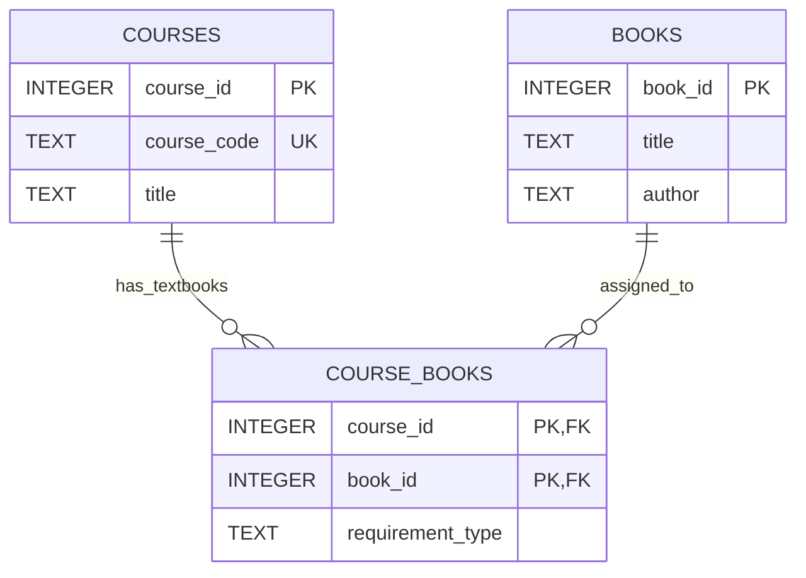

# Feature Specification: University Textbook Store

**Feature Branch**: Not created

**Created**: 2026-11-20

**Status**: Approved specification

**Input**: Approved proposal in `docs/llm-wiki/raw/proposal.md`. University students need to find textbooks associated with a course by course code. Courses may have multiple associated books, and books may be associated with multiple courses. Each course-book association identifies the textbook as required or recommended. Existing bookstore book records remain the source of book details, including price and stock.

## User Scenarios & Testing

### User Story 1 - Find textbooks by course code (Priority: P1)

As a university student, I want to find textbooks by course code so that I can identify the books required or recommended for that course.

**Why this priority**: Finding the correct course materials is the central purpose of this extension.

**Independent Test**: Given synthetic courses, books, and course-book associations, look up a course by its course code and verify that its associated book records and requirement types are returned. Also verify that a course with no associated textbooks returns an empty result.

**Acceptance Scenarios**:

1. **AC-COURSE-01**: Given a course linked to two books, when a student looks up that course by its course code, both associated book records are returned, each with its correct `requirement_type`.
2. **AC-COURSE-02**: Given a course with no associated books, when a student looks up that course by its course code, the result is an empty list and contains no books from other courses.
3. **AC-COURSE-03**: Given an association already exists, when the same (`course_id`, `book_id`) association is attempted again, the database rejects the duplicate and retains at most one such association.
4. **AC-COURSE-04**: Given an association references a nonexistent course or book, when that association is stored, the database rejects it through foreign-key enforcement.
5. **AC-COURSE-05**: Given a course-book association, when its `requirement_type` is stored, only `required` or `recommended` is accepted.

## Scope

**In scope**:

- Finding a course’s textbooks using its course code.
- Representing courses and their titles.
- Representing the many-to-many relationship between courses and existing books.
- Distinguishing required from recommended books for each course-book association.
- Preventing duplicate course-book associations and invalid foreign-key references.

**Out of scope**:

- Changing the six-table core bookstore schema.
- Creating or modifying book records, prices, or stock through this extension.
- University enrollment integration or automatic textbook-list imports.
- Real payment processing, shipping logistics, and production-grade authentication or authorization.

## Requirements

### Functional Requirements

- **FR-001**: A student MUST be able to find a course’s associated textbooks using the course code.
- **FR-002**: A course MUST be identifiable by `course_id` and include a `course_code` and `title`. A course code MUST uniquely identify one course.
- **FR-003**: The system MUST represent course-to-book associations separately from course and book details, so a course can be associated with multiple books and a book can be associated with multiple courses.
- **FR-004**: Each course-book association MUST identify its `requirement_type` as either `required` or `recommended`.
- **FR-005**: The system MUST prevent duplicate associations for the same (`course_id`, `book_id`) pair.
- **FR-006**: Every course-book association MUST reference an existing course and an existing book.
- **FR-007**: A lookup for a course with no associated textbooks MUST return an empty list and MUST NOT return unrelated books.
- **FR-008**: Course-book lookup results MUST identify the associated book and its requirement type. Existing book records remain the source of book attributes such as price and stock.

### Key Entities

- **Course**: A university course identified by `course_id`, with a unique `course_code` and a `title`.
- **Book**: An existing bookstore book record. This extension does not change its core attributes.
- **Course-book association**: The relationship connecting one course to one existing book, with a `requirement_type` of `required` or `recommended`.

## Draft Relational Model and ERD

The following ERD is the approved specification model; it does not authorize or define a migration. `BOOKS` represents the existing core `books` table and remains unchanged.

### Cardinalities

- One course may have zero or many course-book associations; each association refers to exactly one course.
- One book may have zero or many course-book associations; each association refers to exactly one book.
- Therefore, courses and books have a many-to-many relationship through course-book associations.
- Each (`course_id`, `book_id`) pair may appear at most once.

### Draft Integrity Rules

- `courses.course_id` identifies a course.
- `courses.course_code` is unique.
- `course_books.course_id` references `courses.course_id`.
- `course_books.book_id` references the existing `books.book_id`.
- (`course_id`, `book_id`) is unique and forms the association’s composite key.
- `requirement_type` accepts only `required` or `recommended`.

### Why New Relational Entities Are Required

A course has its own identity and attributes (`course_id`, `course_code`, and `title`) that do not belong in an existing book record. The relationship is many-to-many: a course may use several books, and a book may serve several courses. Storing one course identifier on a book would not represent multiple courses for that book without repeating data; storing lists of books on a course would likewise violate relational structure.

The `course_books` relationship also has its own attribute, `requirement_type`, which describes a book’s role for a particular course—not the book or course in isolation. A separate junction entity stores that relationship and its attribute without duplicating course or book details.

### 3NF Rationale

Course code and title depend on the course key, so they belong with the course entity. Existing book attributes remain with the existing book key. The requirement type depends on the complete course-book association, so it belongs on the junction entity keyed by (`course_id`, `book_id`). This separates independent facts and avoids duplicating course or book data across associations.

## Success Criteria

- **SC-001**: For a course associated with textbooks, a lookup by its course code returns every associated book exactly once and identifies each as required or recommended.
- **SC-002**: A course without associations produces an empty result, with no books from other courses.
- **SC-003**: Duplicate (`course_id`, `book_id`) associations and associations to nonexistent courses or books are rejected by database constraints.
- **SC-004**: Only `required` and `recommended` are accepted as requirement types.

## Assumptions

- Course codes uniquely identify courses.
- Course-code lookup uses the supplied course code to identify a course; detailed code normalization rules are not defined in this specification.
- `required` and `recommended` are the only relationship types in this extension.
- The existing bookstore `books` table and its attributes remain unchanged.
- The approved proposal’s excluded areas—including real payment processing, university enrollment integration, and automatic textbook-list imports—remain out of scope.
