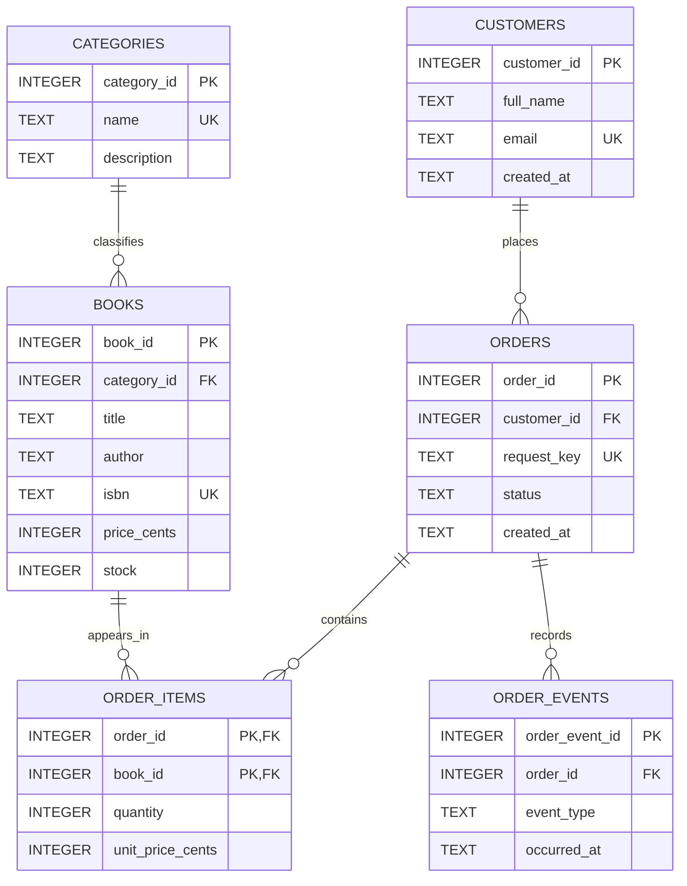

# Relational Data Model — Online Bookstore Lab 1

This proposed model contains all six common tables required by the Lab 1 handout. The initial migration is planned at migrations/0001_initial.sql. No migration file is created in this documentation task. Feature 001 exposes the approved book list, book detail, book search, and category list APIs; customer/order behaviors remain outside the API implementation. Initial catalog currency is USD, and monetary values are stored as integer cents.

## ERD and cardinality

- One category may classify zero or many books; each book has exactly one category.
- One customer may place zero or many orders; each order belongs to exactly one customer.
- Orders and books are many-to-many through order_items. Each line references exactly one order and one book; the composite key permits at most one line per book in an order.
- One order may have zero or many events; every event belongs to one order.
- A committed/confirmed order must contain at least one order_item. This is a transaction/workflow invariant; ordinary foreign keys enforce child-to-parent existence, not parent-to-child minimum cardinality.

## Table definitions and constraints

Surrogate identifiers use INTEGER PRIMARY KEY; order_items uses the composite primary key (order_id, book_id). Foreign keys use ON DELETE RESTRICT to preserve referenced catalog and order history. All monetary values are USD stored as integer cents in price_cents and unit_price_cents. No total amount is stored because it is derivable from order_items.

### categories

- category_id: INTEGER PRIMARY KEY.
- name: TEXT NOT NULL UNIQUE, with CHECK(length(name) > 0).
- description: TEXT NULL.

### books

- book_id: INTEGER PRIMARY KEY.
- category_id: INTEGER NOT NULL, FOREIGN KEY REFERENCES categories(category_id) ON DELETE RESTRICT.
- title: TEXT NOT NULL.
- author: TEXT NOT NULL; one scalar author text value per the approved Lab 1 decision.
- isbn: TEXT NULL UNIQUE; multiple NULL values may represent books without an ISBN.
- price_cents: INTEGER NOT NULL CHECK(typeof(price_cents) = 'integer' AND price_cents >= 0); represents USD cents.
- stock: INTEGER NOT NULL DEFAULT 0 CHECK(stock >= 0) and CHECK(typeof(stock) = 'integer').

### customers

- customer_id: INTEGER PRIMARY KEY.
- full_name: TEXT NOT NULL.
- email: TEXT NOT NULL UNIQUE.
- created_at: TEXT NOT NULL, stored in a consistent ISO-8601 UTC format.
- No payment-card, bank, or payment credential columns.

### orders

- order_id: INTEGER PRIMARY KEY.
- customer_id: INTEGER NOT NULL, FOREIGN KEY REFERENCES customers(customer_id) ON DELETE RESTRICT.
- request_key: TEXT NOT NULL UNIQUE; the caller must reuse the same key for a retry of the same logical request.
- status: TEXT NOT NULL CHECK(status IN ('pending', 'confirmed', 'cancelled')).
- created_at: TEXT NOT NULL, stored in a consistent ISO-8601 UTC format.

### order_items

- order_id: INTEGER NOT NULL, FOREIGN KEY REFERENCES orders(order_id) ON DELETE RESTRICT.
- book_id: INTEGER NOT NULL, FOREIGN KEY REFERENCES books(book_id) ON DELETE RESTRICT.
- quantity: INTEGER NOT NULL CHECK(typeof(quantity) = 'integer' AND quantity > 0).
- unit_price_cents: INTEGER NOT NULL CHECK(typeof(unit_price_cents) = 'integer' AND unit_price_cents >= 0); snapshots the USD catalog price in cents at order time.
- PRIMARY KEY(order_id, book_id), which also provides the UNIQUE constraint for the order/book pair.

### order_events

- order_event_id: INTEGER PRIMARY KEY.
- order_id: INTEGER NOT NULL, FOREIGN KEY REFERENCES orders(order_id) ON DELETE RESTRICT.
- event_type: TEXT NOT NULL CHECK(event_type IN ('created', 'confirmed', 'cancelled')).
- occurred_at: TEXT NOT NULL, stored in a consistent ISO-8601 UTC format.

## 3NF rationale

Each relation describes one entity or one relationship. Every non-key attribute depends on the key, the whole key, and nothing but the key:

- Category name/description depend on category_id, not on book_id; books store only category_id.
- Book title, author, ISBN, current price, stock, and category_id depend on book_id. The approved Lab 1 model treats author as one scalar value and category as one category per book.
- Customer details depend on customer_id; the unique email is a candidate key.
- Order customer, request key, status, and creation time depend on order_id. request_key is an alternate unique key.
- In order_items, quantity and historical unit_price_cents depend on the full composite key (order_id, book_id). Current book price remains in books.
- Event type and time depend on order_event_id; order_id links the event to its order.
- The order total is calculated from quantity × unit_price_cents rather than duplicated in orders, avoiding a separately stored derived value.

## Integrity and index notes

- Required uniqueness: categories.name, books.isbn when present, customers.email, orders.request_key, and order_items(order_id, book_id).
- Required checks: books.stock >= 0; nonnegative catalog and historical prices; positive order quantity; allowed order statuses and event types; nonempty category name.
- Foreign-key indexes may be added for books.category_id, orders.customer_id, order_items.book_id, and order_events.order_id if local tests or query plans show a need. The order_items composite primary key begins with order_id.
- Search must remain parameterized, use ASCII case-insensitive substring semantics, return rows by ascending book_id, and limit to 10. Do not trim or normalize search input; CHG-001 is deferred until after initial testing.
- A future purchase feature must atomically coordinate order, item, event, and stock changes, and must verify the idempotent request_key behavior. This data model alone does not implement that workflow.

## Approved API and response mapping

- GET /api/books returns all book records in ascending book_id order without pagination or a result limit.
- GET /api/books/:id returns a matching book record; an unknown ID returns HTTP 404 with exactly {"error":"Book not found"}.
- GET /api/books/search uses q for ASCII case-insensitive title/author substring matching, ascending book_id order, and a 10-record maximum. Missing q and empty q= both return HTTP 400 with a JSON error response. The exact search-error object keys/message are not specified. The static search route is handled before the dynamic book-ID route. Search input is not trimmed or normalized; CHG-001 remains deferred.
- Every book JSON record includes book_id, category_id, title, author, isbn, price_cents, and stock; isbn remains present with a null value when absent. price_cents uses USD integer cents.
- GET /api/categories returns all categories in ascending category_id order, with category_id, name, and description, without pagination or a result limit; an empty category table returns [].
